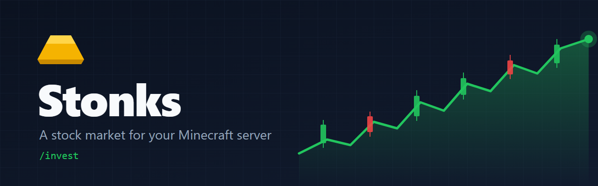

<p align="center">
  
</p>

<p align="center">
  <a href="https://github.com/GeraldR12/Stonks/releases/latest"></a>
  <a href="https://github.com/GeraldR12/Stonks/actions/workflows/build.yml"></a>
  
  
  
</p>

<p align="center">
  <a href="docs/PLAYER_GUIDE.md"><b>Player guide</b></a> ·
  <a href="docs/ADMIN_GUIDE.md"><b>Admin guide</b></a> ·
  <a href="CHANGELOG.md"><b>Changelog</b></a> ·
  <a href="https://github.com/GeraldR12/Stonks/releases/latest"><b>Download</b></a>
</p>

Stonks adds a stock market to Paper servers. Players start companies, buy and sell shares with the server's normal money, and watch prices move every few minutes. Everything goes through Vault, so it works with any Vault economy, including item gold like TheNewEconomy.

## Features

| | |
|---|---|
| **Player companies** | Anyone can found a company with a name, a risk level from 1 to 5, a share count and a starting price. The founder pays its value plus a creation tax and owns every share. |
| **A market that moves** | Prices update on a timer (39 minutes by default). Riskier companies swing harder and are more likely to crash, and a company that hits zero goes bankrupt. |
| **No free money** | Every trade pays a small fee and moves the price against the trader, so buying and selling in a loop always loses gold. |
| **Menus or commands** | Everything works from `/invest` chest menus (click to buy 1, 10 or 100) or from commands with tab completion. |
| **Server account** | Fees and creation tax can go into a server account instead of disappearing. The same account can pay for ExcellentShop's `/shop` and receive Towny's closed economy money. |
| **Crash safe** | Every trade goes through a journal. If the server stops halfway, the trade is held for staff review and never half applied. |
| **Chest shop links** | Company owners can link their QuickShop chest shops to a company. |

## Quick start

1. Install [Vault](https://www.spigotmc.org/resources/vault.34315/) and an economy plugin.
2. Drop `stonks-<version>.jar` from the [latest release](https://github.com/GeraldR12/Stonks/releases/latest) into `plugins/` and restart.
3. Type `/invest` in game.

The console should say `Fresh installation; no data migration needed.` on the first start. An example company, Blocks Corp, is created so the market isn't empty.

## Commands

| Command | What it does |
|---|---|
| `/invest` | Opens the menu: market, portfolio, your companies, notifications. |
| `/invest companies` | Lists every company with its price and free shares. |
| `/invest company info <id>` | Price, risk, history and shareholders of one company. |
| `/invest buy <id> <amount>` | Buys shares. |
| `/invest sell <id> <amount>` | Sells shares. |
| `/invest portfolio` | What you own and the average price you paid. |
| `/invest company create <name> <risk> <shares> <price> [icon]` | Starts a company. |
| `/invest company delete <id>` | Closes your company and pays you its value. |
| `/invest company shop link <id>` | Links the chest shop you're looking at. |

Staff commands (`/invest reload`, `/invest diagnostics`, `/invest reconcile`) and every permission are in the [admin guide](docs/ADMIN_GUIDE.md).

## Compatibility

| | Required | Notes |
|---|---|---|
| Paper | yes | Tested on 26.2 and 26.3. |
| Java | yes | 21 or newer. |
| Vault + an economy | yes | Tested with TheNewEconomy (item gold, whole coins only). |
| QuickShop-Hikari | no | Chest shop links. |
| ExcellentShop | no | `/shop` paid from the server account. Tested with 5.1.7. |
| Towny | no | Closed economy into the same server account. |

## Configuration

`plugins/Stonks/config.yml` holds the price update interval, crash settings, fees, share price limits, the per-player share limit and the server account. Every key is explained in the [admin guide](docs/ADMIN_GUIDE.md#config).

## Building

```bash
mvn package
```

The jar lands in `target/`. `mvn test` runs the test suite (868 tests).

## Contributing

Bug reports and ideas are welcome in [Issues](https://github.com/GeraldR12/Stonks/issues). For code, read [CONTRIBUTING.md](CONTRIBUTING.md) first. Security problems go through [SECURITY.md](SECURITY.md), not public issues.

## Credits

Stonks started as [BlockStreet](https://github.com/Hugo1307/BlockStreet) by Hugo Gonçalves ([@Hugo1307](https://github.com/Hugo1307)). Maintained by Nathan R ([@GeraldR12](https://github.com/GeraldR12)) for the CartMC server.
